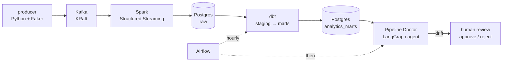
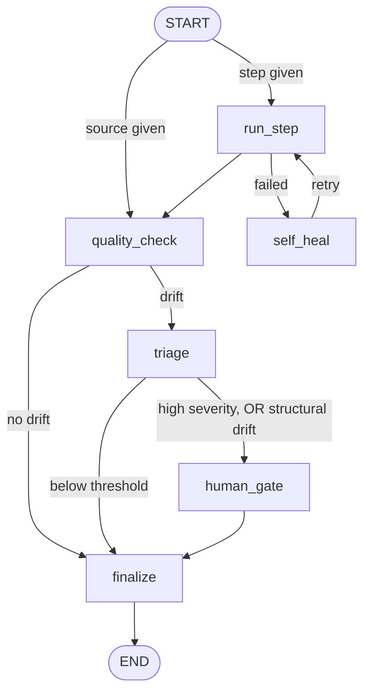

# Real-Time Financial Data Platform

A streaming data pipeline **and** the agent that watches it.

Card transactions stream through Kafka into Spark Structured Streaming, land in
Postgres, and are shaped into BI-ready tables by dbt on an Airflow schedule.
Then **Pipeline Doctor** — a LangGraph agent — profiles every rebuild, detects
drift, classifies it with an LLM, and pauses for human approval before bad data
is accepted downstream.



Everything runs from one `docker compose up`.

## Why this exists

Most pipelines can tell you whether they **ran**. Far fewer can tell you whether
the data they produced is **right**. This project does both, and keeps the two
concerns honest about their limits:

| Question | Answered by | Catches |
|---|---|---|
| Is data still arriving? | `dbt source freshness` | A dead streaming job behind a stack that still looks healthy |
| Is each row valid? | 19 dbt tests | Nulls, duplicates, bad categories, broken keys |
| **Does the data look normal?** | **Pipeline Doctor** | A column that vanished, half the rows missing, a distribution that shifted |

A mart can be fresh, pass every test, and still have lost a column overnight.
That gap is what the agent is for.

## The two halves

### 1. The pipeline

| Layer | Tech | What it does |
|---|---|---|
| `pipeline/producer/` | Python, Faker, kafka-python | Simulates card transactions across 25 accounts, publishes JSON to Kafka |
| Kafka | Apache Kafka 3.7 (KRaft, no ZooKeeper) | `transactions` topic, keyed by `account_id` |
| `pipeline/spark_jobs/` | PySpark Structured Streaming | Raw sink + 1-minute tumbling window aggregation (velocity, average transaction size) per account, with a 2-minute watermark |
| Postgres | PostgreSQL 16 | `raw.transactions`, `raw.account_activity_windows` |
| `pipeline/dbt_project/` | dbt-postgres 1.8 | `staging` views → `marts` tables, with 19 tests and source freshness |
| `airflow/` | Airflow 2.10 (LocalExecutor) | Hourly `dbt source freshness` → `dbt build` → `pipeline_doctor_check` |

**Exactly-once writes.** Both Spark sinks stage each micro-batch through the
JDBC writer, then merge it with `INSERT ... ON CONFLICT DO NOTHING` over a raw
JDBC connection (reached through the JVM gateway, so no extra Python
dependency). A task retry that replays an already-committed batch is a no-op
instead of a duplicate-key crash.

### 2. Pipeline Doctor

An installable package (`pipeline_doctor/`), usable against pipelines other
than this one.

| Layer | Tech | What it does |
|---|---|---|
| `graph.py` | **LangGraph** | State graph with conditional routing, `interrupt()` for human-in-the-loop, SQLite checkpointing so a paused run resumes days later |
| `llm/` | **LangChain** | Provider abstraction + structured output validated against a Pydantic schema — **Claude or Gemini**, switched by one env var |
| `tools/readers/` | psycopg, pandas, pyarrow | Reads **Postgres** (with the server's declared column types), **Parquet**, or **CSV** |
| `tools/data_profiling.py` | pandas | Row counts, null rates, category frequencies, bounded numeric samples |
| `tools/diffing.py` | SciPy | Chi-square for categories, two-sample KS for distributions, schema comparison |



**What it detects**

| Flag | Meaning |
|---|---|
| `schema_column_removed` | A baseline column is gone |
| `schema_column_added` | A new column appeared |
| `schema_dtype_changed` | Same column, different type |
| `row_count` | Total rows moved beyond the threshold |
| `null_rate` | A column's null rate moved |
| `categorical` | A category distribution shifted (chi-square) |
| `numeric` | A value distribution shifted (two-sample KS) |

**Design decisions worth calling out**

- **Structural drift always reaches a human.** A removed or retyped column skips
  the severity threshold entirely. Distributions can legitimately shift; a
  column that stopped existing cannot.
- **It runs without an LLM.** No API key, or the provider returns a 503, and
  deterministic rules assign severity instead. A monitoring tool that goes
  offline when its model does is not monitoring.
- **Types are declared, not guessed.** Reading Postgres directly gives real
  column types. Over CSV, pandas infers them, so an all-null column reads as
  `float64` and looks like a type change — those flags are labelled as
  inferred rather than trusted.
- **Exit codes mean something**: `0` clean, `2` awaiting human review, `1` error.
  A pending review shows as a red Airflow task instead of passing silently.
- **Bounded profiles.** Numeric columns are sampled deterministically rather
  than stored whole — the profile is held twice in graph state (current and
  baseline) and serialized into every checkpoint.

## Quickstart

```bash
cp .env.example .env     # one file for every service; generate a Fernet key (see the comment inside)
docker compose up -d     # kafka, postgres, adminer, producer, streaming-job, airflow
```

- **Airflow** → http://localhost:8080 (`admin` / `admin` by default)
- **Adminer** → http://localhost:8081 (server `postgres`, credentials from `.env`)

Give the streaming job a few minutes on first run: it downloads the
Kafka/Postgres JDBC jars, and the first windowed batch only appears once a
1-minute window closes past its 2-minute watermark.

Run a drift check by hand:

```bash
docker compose exec airflow-scheduler /home/airflow/pd_venv/bin/pipeline-doctor \
  check --source postgres --table analytics_marts.fct_transactions \
  --name findata_fct_transactions --limit 5000
```

Clear a paused review:

```bash
docker compose exec airflow-scheduler /home/airflow/pd_venv/bin/pipeline-doctor \
  resume <thread_id> approve   # or reject
```

`approve` makes the observed data the new baseline; `reject` leaves it alone.

### Batch mode

```bash
docker compose run --rm producer-batch        # 1000 messages, then exits
docker compose run --rm streaming-job-batch   # drains Kafka, then exits
```

`streaming-job-batch` reads from the earliest offset with its own checkpoint, so
it never disturbs the continuous job's offset tracking.

### Tests

```bash
cd pipeline_doctor && pip install -e ".[dev,postgres,parquet]" && pytest    # 93 tests
docker compose run --rm dbt build --profiles-dir .                          # 5 models + 19 tests
```

## Data model

**Raw** (written by Spark)
- `raw.transactions` — one row per transaction event
- `raw.account_activity_windows` — one row per account per 1-minute window

**Staging** (`analytics_staging`, views) — `stg_transactions`,
`stg_account_activity_windows`: type-cleaned, 1:1 with the raw tables. Only
these reference the sources, so a renamed raw column is a one-line change.

**Marts** (`analytics_marts`, tables)
- `dim_accounts` — one row per account, lifetime stats
- `fct_transactions` — transaction fact table with an `is_large_transaction` flag
- `agg_account_activity_daily` — daily rollup of the per-minute windows

## Engineering notes

A few problems that were found and fixed, kept here because they are the
interesting part:

- **A volume mounted where nothing wrote.** `kafka-data` pointed at
  `/tmp/kraft-combined-logs`, but this image's `server.properties` puts
  `log.dirs` at `/tmp/kafka-logs`. The volume stayed empty and Kafka's log lived
  in the container's writable layer, so every container recreate silently reset
  the topic to offset 0 — which surfaced only when Spark's checkpoint pointed at
  an offset that no longer existed.
- **Average of averages.** The daily rollup computed `avg(avg_amount)` over
  per-minute windows, weighting a minute with 1 transaction the same as a minute
  with 40. Now `sum(total_amount) / sum(txn_count)`.
- **A metric that was a rename.** `velocity_per_min` was `txn_count / 1.0` — a
  copy of the count wearing a rate's name. It now divides by the window width,
  from the same constant that builds the window.
- **A test suite that couldn't fail.** Most dbt tests restate constraints the
  database already enforces. `source freshness` is the one that catches the
  failure that looks healthy, so it gates the build.
- **A monitoring tool that crashed when its model did.** A Gemini 503 ended a
  whole run with exit 1 — the exact unattended failure the no-key fallback was
  written to prevent. Checking that a key exists is not the same as the call
  working.

## Known limitations (deliberate, for a demo)

- Spark runs `local[*]` in one container, not a cluster.
- The Kafka topic auto-creates with a single partition, so there is nothing to
  parallelize across at this volume.
- The producer timestamps every event "now", so no event is ever late and the
  2-minute watermark is never actually exercised.
- `amount` is parsed as a float in Spark and only lands as exact cents because
  Postgres rounds on insert; real financial code would use `DecimalType`.
- A message that parses but violates a column limit (an oversized `amount`,
  say) would fail the merge, and Spark would replay that batch forever. The
  producer cannot emit one, so it is unreachable today; the fix is a
  dead-letter table rather than a filter per constraint.
- The streaming half has no Python unit tests — its behaviour is verified by
  running the stack. Pipeline Doctor carries the test suite (93 tests).

## Docs

- `docs/exp.md` — a detailed walkthrough of every file and how the pieces connect
- `docs/plan.md` — the roadmap this was built against, kept as the design record
- `pipeline_doctor/docs/architecture.md` — the agent's graph, profile format and config layering
