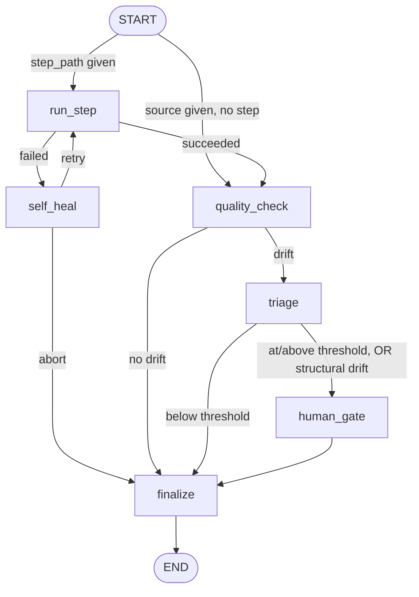

# Pipeline Doctor: architecture

A LangGraph agent that checks whether a pipeline's output data still looks the
way it used to, and pauses for a human when it doesn't.

## The graph



## The nodes

| Node | Does | Notes |
|---|---|---|
| `run_step` | Runs a step script as a subprocess | Skipped entirely when the run names a `source`. Enforces `step_timeout_sec`. |
| `self_heal` | Decides retry vs abort after a failure | LLM-driven; falls back to fixed retry-N without an API key. `max_retries` is a hard ceiling either way. |
| `quality_check` | Reads the data, profiles it, diffs against the baseline | Bootstraps a baseline on first run and reports no drift, rather than comparing against nothing. |
| `triage` | Assigns a severity and explanation | LLM when a key is present, deterministic rules otherwise. |
| `human_gate` | `interrupt()`s the run, awaiting approve/reject | On approve, the observed profile becomes the new baseline. On reject, the baseline is left alone. |
| `finalize` | Appends a run report to `data/runs/<key>.jsonl` | Never raises: losing the report must not lose the outcome. |

## Where the data comes from

`tools/readers/` turns "where the data is" into `(DataFrame, declared_schema)`.

| Kind | `declared_schema` | Why it matters |
|---|---|---|
| `postgres` | Real column types from the server | Schema drift is trustworthy; no step script needed |
| `parquet` | Types stored in the file | Same, for files |
| `csv` | `None` | pandas *infers* types, so an all-null column reads as `float64` and looks like a type change |

Dtype-change flags raised against inferred types are marked `inferred_types`,
so triage and a human can weigh them accordingly.

## What a profile contains

```json
{
  "profile_version": 2,
  "row_count": 5000,
  "schema": {"account_id": "varchar", "amount": "numeric"},
  "schema_source": "declared",
  "null_rates": {"account_id": 0.0},
  "categorical": {"account_id": {"acct_0001": 0.04}},
  "numeric": {"amount": [12.5, 88.0]},
  "numeric_meta": {"amount": {"sampled": 5000, "total": 75700}}
}
```

Numeric columns are a **bounded, deterministic sample**, not the whole column.
The KS test is a two-sample test, so a sample is what it wants; storing the
column whole made profiles large, and state holds two of them (current and
baseline) in every checkpoint.

## Identity

A baseline is filed under a **run key** (`persistence/baseline_store.run_key`):
explicit `--name` > step script name > source (table name, or a hash of the
query). Two sources sharing a key would each overwrite the other's idea of
"normal" and drift detection would quietly compare against the wrong thing, so
anything recurring should pass `--name` explicitly.

## Config layering

```
Settings defaults  ->  environment variables  ->  per-step config file  ->  per-column override
```

The per-step file (`data/configs/<key>.json`) declares column roles and
threshold overrides. It exists because `infer_column_roles` decides roles from
dtype and cardinality alone, with a hardcoded "≤ 20 distinct values" cut for
categoricals — which in the findata pipeline excluded `account_id` (25 values,
a string) from drift testing entirely.

## Exit codes

| Code | Meaning | As a scheduled task |
|---|---|---|
| 0 | No drift, or drift below the review threshold | green |
| 2 | Paused, awaiting human review | red — a pending review should be visible |
| 1 | Step failed, run aborted, or a human rejected the drift | red |
